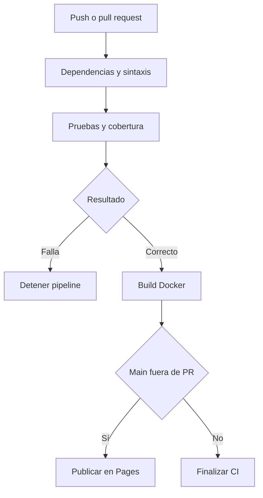

# Documentación del pipeline

Archivo: .github/workflows/ci.yml. CI reúne checkout, Node 22, npm ci, revisión de sintaxis, Jest con cobertura y build Docker. CD depende del éxito de CI y publica únicamente public/ en Pages desde main. Las PR ejecutan CI sin desplegar. workflow_dispatch permite repetir la ejecución desde Actions.

La imagen se etiqueta con el SHA del commit y solo se construye. El artefacto de cobertura conserva lcov.info, reporte HTML y resumen JSON. collectCoverageFrom mide la lógica de la API y el validador; no mide la interfaz ni el archivo que abre el puerto. Las pruebas de integración usan el servidor Express en memoria de Supertest.

El control de concurrencia serializa los despliegues. Los permisos de publicación están limitados al job de Pages. Si falta activar Pages en Settings, el deploy puede fallar aunque las pruebas estén correctas.
